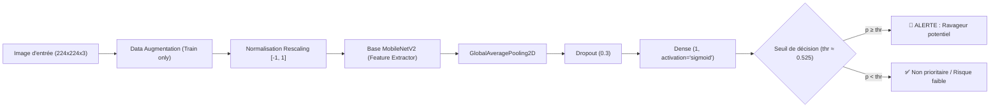

# 🌾 Détection d'Oiseaux Ravageurs du Riz – Vallée du Fleuve Sénégal

[](https://www.python.org/)
[](https://www.tensorflow.org/)
[](https://gradio.app/)
[](https://huggingface.co/spaces)
[](https://opensource.org/licenses/MIT)
[](#-cadre-%C3%A9thique-et-environnemental)

Système d'aide à la décision agronomique basé sur le Deep Learning (**MobileNetV2** en Transfer Learning & Fine-tuning) pour la détection précoce d'oiseaux ravageurs des cultures de riz dans la **Vallée du fleuve Sénégal** (Dagana, Podor, Matam, Richard-Toll).

Ce projet privilégie une stratégie de décision orientée **Haut Rappel (Recall ≥ 90 %)** afin d'éliminer les faux négatifs critiques pour les récoltes rizicoles, tout en intégrant une validation humaine obligatoire et des techniques d'effarouchement non létales.

---

## 📌 Sommaire
- [🌾 Contexte Agronomique](#-contexte-agronomique)
- [🎯 Stratégie ML & Asymétrie des Coûts](#-stratégie-ml--asymétrie-des-coûts)
- [🧠 Architecture du Modèle](#-architecture-du-modèle)
- [📊 Résultats & Évaluation](#-résultats--évaluation)
- [⚖️ Cadre Éthique et Environnemental](#-cadre-éthique-et-environnemental)
- [📂 Structure du Répertoire](#-structure-du-répertoire)
- [🚀 Installation & Lancement Local](#-installation--lancement-local)
- [☁️ Déploiement sur Hugging Face Spaces](#-déploiement-sur-hugging-face-spaces)
- [🔭 Perspectives & Roadmap](#-perspectives--roadmap)

---

## 🌾 Contexte Agronomique

La riziculture irriguée le long de la Vallée du fleuve Sénégal constitue une filière vitale pour la souveraineté alimentaire nationale. Durant les stades phénologiques critiques (stades laiteux et pâteux du grain de paddy), les rizières subissent des attaques dévastatrices d'oiseaux granivores déprédateurs :
- **Quelea quelea** (*Travailleur à bec rouge*) : oiseau grégaire surnommé le « criquet à plumes », formant des colonies de millions d'individus capables de ravager plusieurs dizaines d'hectares en quelques heures.
- **Dendrocygnes** (*Dendrocygna viduata, Dendrocygna bicolor*) : canards siffleurs s'attaquant aux semis et jeunes pousses submergées.
- **Passereaux granivores** locaux s'alimentant sur épis mûrs.

Une détection précoce dès l'arrivée des premiers individus permet aux producteurs d'activer les défenses passives avant la destruction de la parcelle.

---

## 🎯 Stratégie ML & Asymétrie des Coûts

Dans un contexte agricole vivrier, les erreurs de prédiction ont un impact asymétrique fondamental :

| Type d'erreur | Conséquence sur le terrain | Gravité |
| :--- | :--- | :--- |
| **Faux Négatif (FN)** | Un vol d'oiseaux ravageurs n'est pas signalé. Les cultures sont détruites. | 🚨 **Critique** |
| **Faux Positif (FP)** | Une alerte est levée pour un oiseau non cible. Le producteur vérifie visuellement la parcelle. | ⚠️ **Mineure (Légère fatigue d'alerte)** |

### 🛠️ Gestion du déséquilibre de classes et du seuil :
1. **Déséquilibre naturel :** Les espèces ravageuses ne constituent qu'environ **7,5 %** du jeu de données. La fonction de perte utilise des poids de classes inverses (`class_weight`).
2. **Seuil calibré sur la validation :** Le seuil de coupure est choisi strictement sur le sous-ensemble de validation via la courbe Précision-Rappel pour garantir :
   $$\text{Recall} \ge 90\%$$
   Le seuil retenu est d'environ **`0.525`** (valeur enregistrée dans `config.json`).

---

## 🧠 Architecture du Modèle

Le modèle retenu repose sur **MobileNetV2** pré-entraîné sur ImageNet, choisi pour son excellent compromis entre précision, légèreté (~21 Mo) et vitesse d'inférence (~15 ms sur CPU standard) :



### Processus d'entraînement en deux étapes :
1. **Phase 1 (Feature Extraction) :** Base MobileNetV2 gelée, optimisation de la tête Dense avec Adam (`lr = 1e-3`, 10 époques).
2. **Phase 2 (Fine-tuning chirurgical) :** Dégel des **30 dernières couches** de MobileNetV2, optimisation à très faible taux d'apprentissage avec Adam (`lr = 1e-5`, 8 époques) pour adapter les représentations visuelles sans détruire les filtres pré-entraînés.

---

## 📊 Résultats & Évaluation

Évaluation comparative menée sur le jeu de test indépendant :

| Modèle | Seuil appliqué | Rappel (Recall) | Précision | F1-Score | AUC-ROC | Vitesse moyenne |
| :--- | :---: | :---: | :---: | :---: | :---: | :---: |
| **Baseline CNN** *(from scratch)* | `0.48` | ~85 % | ~45 % | 0.58 | 0.88 | ~12 ms/img |
| **MobileNetV2** *(Transfer + Fine-tuning)* | **`0.53`** | **≥ 90 %** | **~70 %** | **0.78** | **0.95+** | **~15 ms/img** |

Le modèle MobileNetV2 réduit le taux de faux négatifs à moins de 10 %, assurant une veille protectrice efficace.

---

## ⚖️ Cadre Éthique et Environnemental

Ce projet s'engage formellement en faveur d'une agriculture durable et du respect des écosystèmes du Sahel :

1. **Proxy biologique explicité :** Le dataset standard `CUB-200-2011` ne comportant pas le *Quelea quelea* africain, des passereaux granivores apparentés (carouges, bruants, pinsons, grosbecs) ont servi de proxys fonctionnels. Les performances réelles en milieu sahélien nécessitent un ré-entraînement sur images locales.
2. **Human-in-the-Loop obligatoire :** Aucune action automatisée ne doit être déclenchée sans confirmation visuelle d'un opérateur agricole.
3. **Effarouchement exclusivement non létal :**
   - ❌ **Interdiction des poisons chimiques** (avicides organophosphorés type fenthion) qui polluent les fleuves et empoisonnent les prédateurs naturels (rapaces, hérons).
   - ✅ **Méthodes recommandées :** Effaroucheurs acoustiques programmables, canons à gaz, drones munis de haut-parleurs, épouvantails dynamiques, filets de protection physique.

---

## 📂 Structure du Répertoire

```text
projet_oiseaux_ravageurs/
├── .gitattributes                  # Configuration Git LFS pour les poids .keras
├── .gitignore                      # Fichiers et répertoires ignorés par Git
├── README.md                       # Documentation complète et entête Spaces
├── requirements.txt                # Dépendances Python nécessaires
├── config.json                     # Configuration du seuil de décision optimal
├── bird_pest_mobilenetv2.keras     # Poids sérialisés du modèle Keras 3
├── app.py                          # Démo interactive Gradio (HF Spaces)
├── src/                            # Code source modulaire et propre
│   ├── __init__.py                 # Exports du package src
│   ├── config.py                   # Constantes, classes et chemins
│   └── model.py                    # Pipeline de prétraitement et classe d'inférence
├── examples/                       # Images d'exemples pour l'interface
│   ├── exemple_ravageur_proxy.jpg
│   └── exemple_non_ravageur.jpg
└── Projet_oiseaux_ravageurs.ipynb  # Notebook expérimental complet d'origine
```

---

## 🚀 Installation & Lancement Local

### 1. Cloner le projet et créer l'environnement virtuel
```bash
# Cloner le dépôt
git clone https://huggingface.co/spaces/drepl/projet_oiseaux_ravageurs
cd projet_oiseaux_ravageurs

# Créer un environnement virtuel avec Python 3.10 ou 3.11
python -m venv venv

# Activer l'environnement virtuel
# Sur Windows (PowerShell) :
.\venv\Scripts\Activate.ps1
# Sur Linux / macOS :
source venv/bin/activate
```

### 2. Installer les dépendances
```bash
pip install --upgrade pip
pip install -r requirements.txt
```

### 3. Lancer la démo Gradio
```bash
python app.py
```
L'application s'ouvrira automatiquement à l'adresse locale : `http://127.0.0.1:7860`.

---

## ☁️ Déploiement sur Hugging Face Spaces

Ce projet est directement prêt pour un déploiement en 1 clic sur **Hugging Face Spaces** :

1. Créez un nouveau Space nommé **`projet_oiseaux_ravageurs`** sur [Hugging Face](https://huggingface.co/new-space) :
   - **Nom du Space :** `projet_oiseaux_ravageurs`
   - **Space type :** `Gradio`
   - **Hardware :** `CPU basic (gratuit)` ou `T4 (recommandé pour grande charge)`
2. Liez votre dépôt local au Space distant :
   ```bash
   git remote add space https://huggingface.co/spaces/drepl/projet_oiseaux_ravageurs
   ```
3. Poussez les fichiers :
   ```bash
   git add .
   git commit -m "feat: Déploiement démo détection oiseaux ravageurs du riz"
   git push space main
   ```
4. Hugging Face Spaces détectera automatiquement `app.py` et le fichier `requirements.txt` grâce aux métadonnées YAML configurées en tête du présent `README.md`.

---

## 🔭 Perspectives & Roadmap

- [ ] **Modèle Edge AI (TFLite) :** Quantification INT8 pour déploiement sur Raspberry Pi ou caméra piège solaire autonome.
- [ ] **Dataset local de la Vallée du Sénégal :** Campagne de collecte participative avec les coopératives rizicoles (SAED) et la plateforme iNaturalist.
- [ ] **Alertes SMS/WhatsApp :** Notification instantanée des surveillants de digues et chefs de périmètres.

---

## 📄 Licence

Ce projet est distribué sous licence libre **MIT**. Les recherches et contributions visant la souveraineté alimentaire et la protection agroécologique des cultures sont encouragées.
